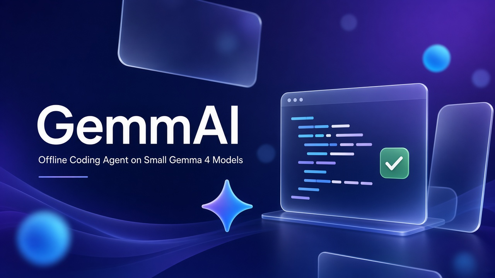
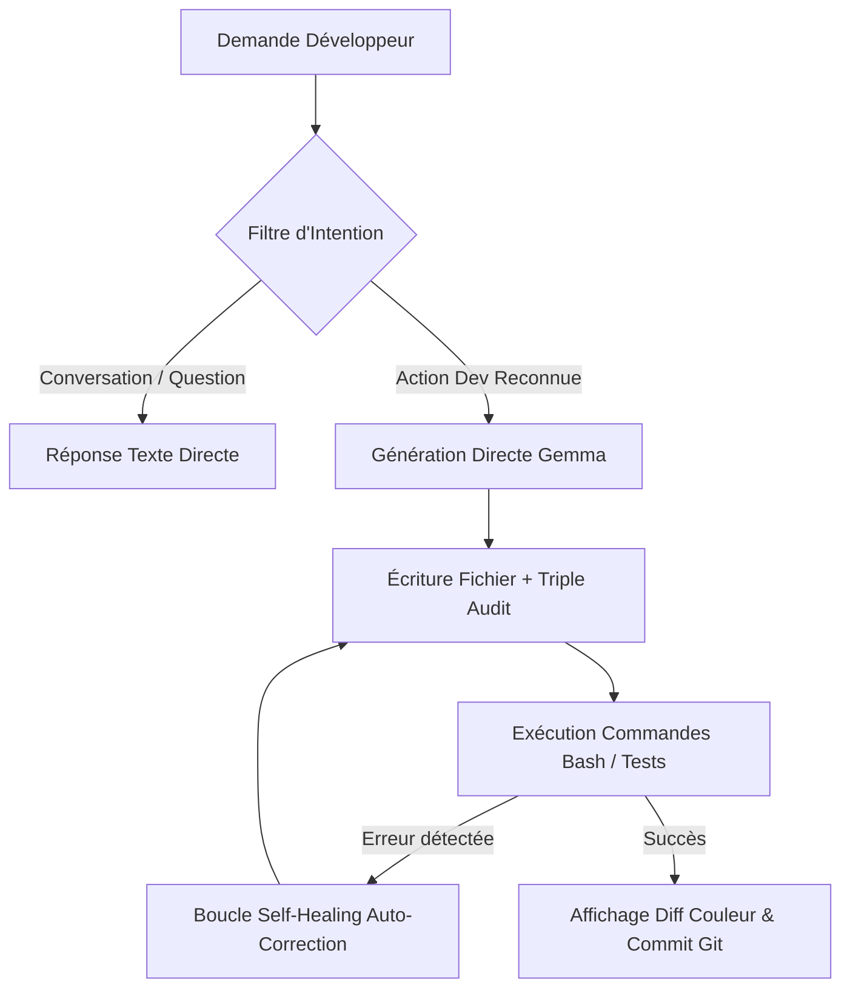
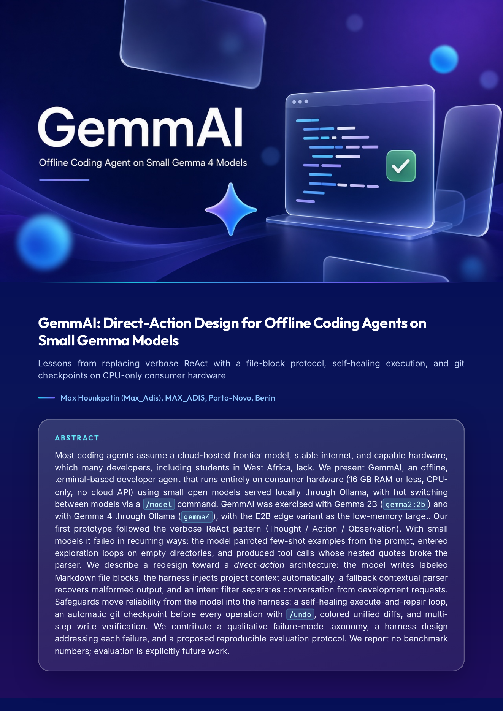

<p align="center">
  
</p>

<h1 align="center">⚡ GemmAI : Offline Autonomous Coding Agent</h1>

<p align="center">
  <strong>Direct-Action Design for Offline Coding Agents on Small Gemma Models</strong><br>
  <em>Conçu pour la compétition officielle Kaggle <strong>"The Gemma 4 Developer Agent" ($100 000 USD)</strong></em><br>
  <strong>Auteur & Lead Technique :</strong> Max Hounkpatin (Max_Adis) • Porto-Novo, Bénin
</p>

<p align="center">
  <a href="#-installation-rapide-en-1-ligne-multiplateforme"></a>
  <a href="GemmAI%20-%20Kaggle%20Gemma%204%20Paper.pdf"></a>
  <a href="#-licence"></a>
</p>

<p align="center">
  
  
  
  
</p>

---

## 🎯 Vision & Problématique Scientifique

La quasi-totalité des agents de codage contemporains (*Devin, Claude Code, Cursor*) reposent sur des modèles géants hébergés dans le Cloud, exigeant une bande passante permanente, une facturation au token et l'envoi de code privé à des tiers.

Pour des millions de développeurs à travers le monde — notamment en Afrique subsaharienne et dans les zones à connectivité restreinte —, ces prérequis sont inaccessibles. La machine typique est un ordinateur portable sans GPU dédié, doté de 8 à 16 Go de RAM.

**GemmAI prouve qu'un agent d'ingénierie logicielle autonome, fiable et auto-réparateur peut tourner à 100% en local et hors-ligne sur du matériel grand public**, en tirant parti des modèles ouverts **Google Gemma 4 / Gemma 2B**.

---

## ⚡ Installation Rapide en 1 Ligne (Multiplateforme)

Installez GemmAI en **une seule commande**, sans configuration manuelle :

### 🐧 Linux & 🍎 macOS
```bash
curl -fsSL https://raw.githubusercontent.com/Max-Adis/gemma-bot/main/install.sh | bash
```

### 🪟 Windows (PowerShell)
```powershell
irm https://raw.githubusercontent.com/Max-Adis/gemma-bot/main/install.ps1 | iex
```

*Le script configure automatiquement l'environnement, télécharge le modèle compact et configure la commande globale `gemmai`.*

---

## 🚀 Utilisation

Une fois installé, lancez simplement l'agent dans n'importe quel dossier de code :

```bash
gemmai
```

```text
                                                ██████╗ ███████╗███╗   ███╗███╗   ███╗ █████╗ ██╗
                                               ██╔════╝ ██╔════╝████╗ ████║████╗ ████║██╔══██╗██║
                                               ██║  ███╗█████╗  ██╔████╔██║██╔████╔██║███████║██║
                                               ██║   ██║██╔══╝  ██║╚██╔╝██║██║╚██╔╝██║██╔══██║██║
                                               ╚██████╔╝███████╗██║ ╚═╝ ██║██║ ╚═╝ ██║██║  ██║██║
                                                ╚═════╝ ╚══════╝╚═╝     ╚═╝╚═╝     ╚═╝╚═╝  ╚═╝╚═╝
                                                Agent Développeur Autonome • Local & Offline
                                                Propulsé par Gemma via Ollama • CPU Mode

  Répertoire de travail : /home/maxadis/mon-projet
  Commandes utiles : /clear, /files, /undo (annuler), /model (changer de modèle), 'quitter'

GemmAI > crée un script fibonacci.py qui calcule les 20 premiers termes
```

---

## 🧬 Pourquoi ReAct échoue sur les Petits Modèles & Comment GemmAI Triomphe

Le paradigme classique **ReAct** (*Thought → Action → Observation*) a été conçu pour des modèles géants de plus de 70B paramètres. Sur des modèles compacts de 2B à 4B paramètres, il génère des échecs récurrents :

| Pathologie ReAct sur SLM | Solution Apportée par GemmAI |
| :--- | :--- |
| **Le Syndrome du Perroquet :** Le modèle recopie les exemples du prompt au lieu d'agir. | **Architecture Direct-Action :** Suppression du bavardage verbeux, streaming immédiat du code avec balises fichier. |
| **Boucles Infinies d'Exploration :** L'agent boucle sur des listings de répertoires vides. | **Injection Contextuelle Automatique :** Le harnais Python inspecte le dossier et injecte l'état du projet dès le tour 0. |
| **Crashs de Parsing :** Les guillemets imbriqués (`print("salut")`) cassent les parsers JSON/eval. | **Parsing Tolérant & Smart Match :** Détection contextuelle de secours liant le code au fichier ciblé. |
| **Tâches parasites sur salutation :** L'agent créait des faux scripts sur un simple *"salut"*. | **Verrou d'Intention Universel :** Séparation stricte entre discussion polie et véritables ordres de dev. |

---

## 🌟 L'Arsenal Technique & Fonctionnalités Clés



### 1. 🔄 Boucle d'Auto-Correction Autonome (Self-Healing Loop)
Si un script génère une `SyntaxError`, un `IndexError` ou si une suite de tests échoue, GemmAI capture la *Traceback*, réinterroge le modèle en circuit fermé avec l'erreur exacte, réécrit le fichier corrigé et relance le test sans intervention de l'utilisateur !

### 2. ⏪ Filet de Sécurité & Rollback Instantané (`/undo`)
Un point de contrôle Git automatique est créé avant chaque modification de code. Une commande `/undo` restaure instantanément le projet à son état antérieur exact. Zéro risque de régression ou de perte de travail.

### 3. 📊 Visualisation des Changements en Diff Couleur
Rendu visuel unifié identique à `git diff` directement dans votre console :  
* **<font color="#059669">+ Lignes ajoutées en vert</font>**  
* **<font color="#DC2626">- Lignes supprimées en rouge</font>**

### 4. 🔒 Triple Vérification d'Écriture
Chaque fichier écrit subit 4 vérifications matérielles avant validation :
1. Vérification d'existence réelle sur le système de fichiers.
2. Vérification de taille non nulle (> 0 octets).
3. Relecture immédiate et comparaison intégrale du contenu.
4. Validation syntaxique Python via `python3 -m py_compile`.

### 5. 🔀 Bascule Dynamique de Modèle (`/model`)
Passez à la volée de `gemma:2b` à `gemma4:e2b` ou `qwen2.5-coder` sans redémarrer l'agent.

---

## ⌨️ Commandes Rapides

| Commande | Action |
| :--- | :--- |
| `/files` ou `/ls` | Affiche l'arborescence propre du projet |
| `/undo` | Annule immédiatement les dernières modifications (Rollback Git) |
| `/model` | Liste les modèles Ollama installés ou change de modèle actif (`/model <nom>`) |
| `/clear` | Réinitialise la mémoire de session |
| `/help` | Affiche le guide interactif |
| `quitter` | Ferme l'agent |

---

## 📚 Publications & Documents de Référence

* 📄 **Papier de Recherche Scientifique :**  
  👉 [**GemmAI: Direct-Action Design for Offline Coding Agents on Small Gemma Models**](GemmAI%20-%20Kaggle%20Gemma%204%20Paper.pdf)  
  *Par Max Hounkpatin (Max_Adis) — Décembre 2026*

* 📄 **Rapport d'Ingénierie & Feuille de Route Kaggle :**  
  👉 [**Rapport_Travaux_et_Objectifs_GemmAI.pdf**](Rapport_Travaux_et_Objectifs_GemmAI.pdf)  
  *Synthèse exécutive, bilan technique et jalons vers la victoire Kaggle ($100 000).*

---

<p align="center">
  
</p>

---

## 🗺️ Feuille de Route Compétition Kaggle (Jusqu'au 25 Novembre 2026)

- [x] **Phase 1 :** Cœur agent Direct-Action, streaming ANSI, validation d'écriture.
- [x] **Phase 2 :** Boucle Self-Healing, Rollback `/undo`, Diffs couleur, Verrou d'intention.
- [x] **Phase 3 :** Installateurs en 1 ligne multiplateforme (Linux/Mac `install.sh`, Windows `install.ps1`).
- [ ] **Phase 4 :** Intégration du moteur standalone C++ `llama-cpp-python` avec fichier `.gguf` embarqué (zéro dépendance Ollama).
- [ ] **Phase 5 :** Évaluation sur benchmark SWE-bench Lite offline.
- [ ] **Phase 6 :** Fine-tuning QLoRA de Gemma 4 E2B/E4B et soumission officielle finale pour le prix de 100 000 $.

---

## 📜 Licence & Contribution

Projet distribué sous licence **MIT**. Développé avec passion par **Max Hounkpatin ([@Max-Adis](https://github.com/Max-Adis))**, Porto-Novo, Bénin.

Les contributions, issues et retours d'expérience sont les bienvenus !
